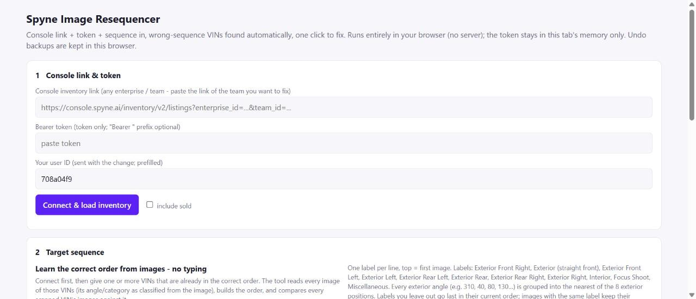
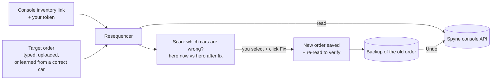
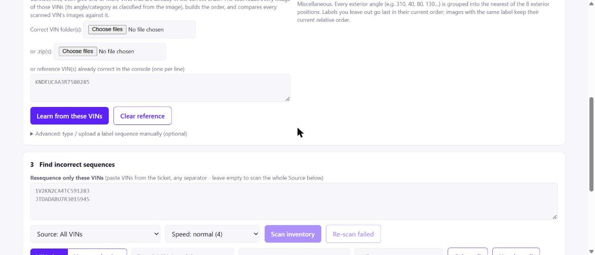
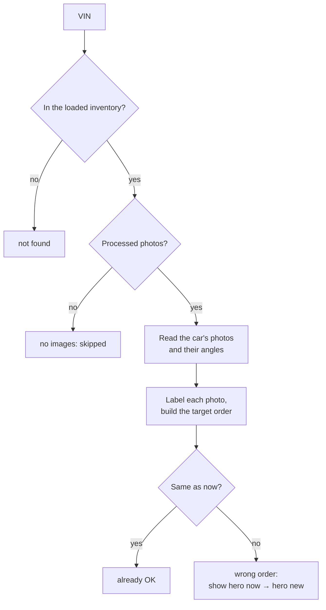

# Spyne Image Resequencer: Fix Photo Order for Hundreds of Cars in One Click

> **When a car's photos are in the wrong order in the Spyne console, the wrong photo becomes the first photo
> ("hero") on the dealer's website.** Fixing it by hand means opening each car, dragging photos into place and
> saving, one car at a time. The Resequencer finds every car whose photos are out of order and fixes them all in
> one click, with a preview first and an undo after.

| | |
|---|---|
| **What it is** | A browser tool (one HTML page) plus an optional local version (`app.py`) |
| **Live link** | **https://karmendrashekhawat2004.github.io/spyne-image-resequencer/resequencer.html** |
| **Works on** | Any Spyne console team: paste the team's inventory link and your console token |
| **What it changes** | Only the **order** of a car's photos, using the same call as the console's *Images › Resequence › Save Sequence* button |
| **Safety** | Preview before any change, one-click undo, token kept in memory only, nothing changed until you click **Fix** |
| **Needs** | A browser. The local version needs Python 3.8+ and **no extra packages** |
| **Size** | About 1,400 lines: `app.py` (680), `resequencer.html` (480), `index.html` (260) |
| **Project** | Spyne catalogue team project · built and maintained by **Karmendra Singh** |



*The original technical notes are in [`docs/TECHNICAL.md`](docs/TECHNICAL.md).*

---

## Contents

1. [The problem](#1-the-problem)
2. [What the tool does, in one picture](#2-what-the-tool-does-in-one-picture)
3. [How to use it (screen by screen)](#3-how-to-use-it-screen-by-screen)
4. [How it works inside (explained without jargon)](#4-how-it-works-inside-explained-without-jargon)
5. [A walk through the real code](#5-a-walk-through-the-real-code)
6. [Safety by design](#6-safety-by-design)
7. [How I built it](#7-how-i-built-it)
8. [Results and what comes next](#8-results-and-what-comes-next)
9. [Questions a manager may ask](#9-questions-a-manager-may-ask)
10. [Glossary](#10-glossary)

---

## 1. The problem

Every car Spyne processes has a set of photos: front, sides, rear, interior, close-ups. Each dealer wants them
in a fixed order, for example:

```
1. Exterior Front Right      6. Exterior Rear
2. Exterior (straight front) 7. Exterior Rear Right
3. Exterior Front Left       8. Exterior Right
4. Exterior Left             9. Interior
5. Exterior Rear Left       10. Focus Shoot (close-ups)
```

The **first photo** is the one buyers see in search results and on the dealer's website. If the order is wrong,
a car can be listed with an interior shot or a rear view first.

Photos end up in the wrong order for many reasons: photos uploaded from the app in a different order, re-shoots,
a changed dealer preference, or FTP / console uploads. Fixing it by hand:

| Step per car | Time |
|---|---|
| Find the car in the console | seconds to a minute |
| Open *Images › Resequence* | a few seconds |
| Drag 10 to 40 photos into the right place | 1 to 3 minutes |
| Save, check it worked | 30 seconds |
| **Repeat for every car of every dealer** | **hours for one dealer** |

And first you have to *find* which cars are wrong, which means opening every car.

---

## 2. What the tool does, in one picture



1. **Connect** to a console team.
2. **Tell it the correct order**, or let it **learn** the order from a car that is already correct.
3. **Scan**: it checks every car and lists the ones in the wrong order, showing the current first photo and the
   first photo after the fix.
4. **Fix** the selected cars. Each fix is checked by reading the car back.
5. **Undo** any fix from its backup.

---

## 3. How to use it (screen by screen)

### Step 1: Console link and token


| Field | What to put |
|---|---|
| **Console inventory link** | The link of the team's inventory page in the Spyne console. The tool reads the enterprise and team from it |
| **Bearer token** | Your console login token. It stays in this browser tab's memory only and is never saved |
| **Your user ID** | Pre-filled; it is sent with each change so the console records who made it |
| **Connect & load inventory** | Loads the team's cars (tick *include sold* to include sold cars) |

### Step 2: Target sequence



Three ways to give the correct order, from easiest to most manual:

1. **Learn from correct VINs** (no typing): enter one or more VINs that are already in the right order in the
   console and click **Learn from these VINs**. The tool reads their photos and builds the order.
2. **Upload a correct folder or zip**: a folder of correctly ordered photos (file names such as
   `1_7_Exterior_<imageid>.jpg`). Each photo is looked up in the console to get its angle, and the order is built
   from the folder. The tool shows how many files matched and whether a label sort reproduces the folder exactly.
3. **Type or upload a label list**: one label per line, first line = first photo. Short forms such as `fr`,
   `front left`, `rear` or an angle such as `320` are understood.

### Step 3: Find incorrect sequences

* Paste only the VINs from a ticket, or leave it empty to scan the whole team.
* Choose the **Source**: all VINs, Spyne App (iOS + Android) only, or one source such as FTP or Console. The list
  shows how many cars each source has.
* Choose the **Speed** (2, 4 or 8 cars at a time). Lower it if the console answers slowly.
* **Scan inventory**. Results appear live. Cars without processed photos are skipped at once; failed reads are
  retried; **Re-scan failed** re-checks the rest. **Stop** cancels the scan. Nothing is changed during a scan.

Two views of the results:

| View | Shows |
|---|---|
| **VIN view** | A table with a status filter, search, and *hero now → hero after fix* for every car |
| **Hero angle view** | A card grid like the console, filterable by the current hero photo. Click a car for before / after photo strips |

### Step 4: Fix selected

Select the cars and click **Fix selected**. For each car the tool saves a backup of the current order, sends the
new order, waits a moment, reads the car again and confirms the order really changed (**verified**).

### Step 5: Undo

Pick one or more backups and restore the original order.

---

## 4. How it works inside (explained without jargon)

### 4.1 Every photo gets a position label

Each processed photo in the console has a category (exterior, interior, focus shoot) and, for exterior photos, an
**angle** from 0° to 359°. The tool turns every angle into one of **eight positions** around the car:

```
                 0°  Exterior (straight front)
      315° Front Right          45° Front Left
   270° Right          CAR          90° Left
      225° Rear Right           135° Rear Left
                 180° Rear
```

An angle goes to the nearest position (for example 310° → Front Right, 80° → Left). Interior and Focus Shoot
photos keep their own labels.

### 4.2 Sorting without breaking anything

The new order is a **stable sort**: photos are grouped by the position of their label in your sequence, and
photos with the same label (for example ten interior shots) **keep their current order among themselves**.
Labels you did not list go to the end, in their current order. So the tool only moves what must move.

### 4.3 What a scan does for one car



### 4.4 Two versions, same logic

| Version | How it runs | Best for |
|---|---|---|
| **`resequencer.html`** (live link) | Entirely in the browser; talks to the Spyne API directly; backups kept in the browser | Daily use, nothing to install |
| **`app.py` + `index.html`** | A small Python server on your PC (`127.0.0.1:8765`); backups saved as files in `backups/` | Very large batches, file backups, folder uploads |

Both use exactly the same rules (the browser version is a translation of `app.py`).

### 4.5 Ten words that explain the inside

| Word | Plain meaning | Everyday comparison |
|---|---|---|
| **API** | A fixed way for programs to ask the console for data or changes | An order counter with a standard form |
| **Bearer token** | Proof that you are logged in, sent with every request | A visitor badge |
| **VIN** | A car's unique 17-character serial number | A car's Aadhaar number |
| **Media ID / image ID** | The console's IDs for a car's photo set and each photo | A file number and page numbers |
| **Angle** | Which direction the camera looked at the car, 0–359° | Clock positions around the car |
| **Stable sort** | Sorting that keeps equal items in their original order | Re-shelving books by subject without shuffling each shelf |
| **Parallel workers** | Several cars checked at the same time | Several cashiers open at once |
| **Backup** | The old photo order saved before a change | A photocopy before you edit |
| **Verify / read-back** | Reading the car again to confirm the change stuck | Checking the receipt |
| **localStorage** | A small storage space inside your browser | A drawer in your own desk |

---

## 5. A walk through the real code

### 5.1 Angle to position (`app.py`)

```python
SECTORS = ["Exterior", "Exterior Front Left", "Exterior Left", "Exterior Rear Left",
           "Exterior Rear", "Exterior Rear Right", "Exterior Right", "Exterior Front Right"]

def angle_to_label(angle):
    """Console-style label for any angle: nearest of 8 sectors (0 = straight front, clockwise 45 deg each)."""
    return SECTORS[int(round((int(angle) % 360) / 45.0)) % 8]
```

| Part | In plain English |
|---|---|
| `SECTORS = [...]` | The eight positions in order, one every 45°, starting at the straight front |
| `angle % 360` | Keep the angle inside one circle (370° becomes 10°) |
| `/ 45.0` then `round(...)` | Which 45° slice is closest (310 ÷ 45 = 6.9 → 7) |
| `% 8` | 360° wraps back to the front (8 → 0) |
| `SECTORS[...]` | Pick that position's name (7 → "Exterior Front Right") |

### 5.2 Building the new order (`app.py`)

```python
def build_target(imgs, seq):
    """Stable re-order: images grouped by the label order in `seq`; unlisted labels go last."""
    seq = expand_seq(seq)
    rank = {lab: i for i, lab in enumerate(seq)}
    big = len(seq) + 1
    keyed = [(rank.get(image_label(im), big), idx, im) for idx, im in enumerate(imgs)]
    keyed.sort(key=lambda t: (t[0], t[1]))
    return [t[2] for t in keyed]
```

* `rank` gives every label in your sequence a number: Front Right = 0, Front = 1, ...
* For every photo it makes a small tag: *(its label's number, its current position, the photo)*. A label you did
  not list gets a big number, so it goes last.
* Sorting by *(label number, current position)* puts photos in your order, and photos with the same label stay in
  their current order. That is the "stable" part.

### 5.3 Fixing one car safely (`app.py`)

```python
def apply_one(vin, seq, user_id):
    """Re-reads the vehicle, re-plans, backs up, posts, verifies."""
    p = plan_one(vin, seq)                                   # 1. read the car again, plan again
    ...json.dump({"original_order": [...], "applied_order": [...]}, f)   # 2. backup first
    api("POST", "/inventory/v2/media/image-sequencing", body)            # 3. same call as the console button
    time.sleep(0.8)
    _, _, after = get_vehicle_images(p["dealerVinId"])                   # 4. read it back
    ok = [i["image_id"] for i in after] == [t["id"] for t in p["target"]]
    return {"result": "applied" if ok else "applied_unverified", ...}    # 5. say if it really worked
```

The five steps in order: **re-read** (the car may have changed since the scan), **back up**, **send**, **read
back**, **report honestly**. If the console accepted the change but the order read back is different, the result
says *applied_unverified* and asks you to check, instead of claiming success.

### 5.4 One bad car never stops the scan (`app.py`)

```python
def _scan_one(v, seq):
    try:
        return plan_one(v, seq)
    except AuthError as e:          # token expired: stop everything with a clear message
        SCAN["cancel"] = True
        SCAN["error"] = str(e)
    except Exception as e:          # any other problem: report this VIN and carry on
        return {"vin": v, "status": "error", "message": "%s: %s" % (type(e).__name__, e)}
```

An expired login stops the whole scan at once with a clear message; any other problem is recorded for that one
car and the scan continues with the others.

---

## 6. Safety by design

| Risk | How the tool handles it |
|---|---|
| Changing the wrong thing | It only changes photo **order**, never photos themselves, and only for cars you select |
| A surprise change | Scans never change anything. Every fix is shown before / after first |
| A change that didn't stick | Every fix is read back and marked *verified* or *unverified* |
| Needing to go back | A backup of the old order is saved before every fix; **Undo** restores it |
| Token leaking | The token is kept in memory only, never written to disk or sent anywhere except the Spyne API |
| Overloading the console | Adjustable speed (2 / 4 / 8 at a time); slow answers are retried; **Stop** button |
| Expired login mid-run | Detected at once (HTTP 401), the scan stops with a clear message |
| Missing photos | Cars missing positions compared with the reference car (e.g. no interior) get a warning |

Good practice, also shown in the tool: preview first, try one VIN before a batch, and never paste a token into
chat or e-mail.

---

## 7. How I built it

I come from catalogue operations, not from a computer-science background. I knew the problem from daily work:
dealers complaining about the wrong first photo, and hours spent dragging photos in the console. I built the tool
with an **AI coding assistant**, which writes code from instructions in plain language.

### 7.1 Who did what

| I did | The AI assistant did |
|---|---|
| Found the console call the *Save Sequence* button makes, by watching the console in the browser | Wrote the Python and JavaScript that make the same call |
| Defined the target orders the dealers want and the 8 positions | Turned them into the labelling and sorting logic |
| Asked for "learn from a correct car, no typing" | Built the folder / zip / VIN learning and the checks |
| Tested on real VINs, one car first, then batches | Added retries, speed control, stop, error banners |
| Asked for a version that needs no installation | Translated the engine into a single browser page |
| Decided the safety rules: preview, backup, verify, undo | Implemented them in both versions |

### 7.2 Steps

1. **Watch the manual process**: what the console sends when *Save Sequence* is clicked.
2. **Read before write**: first a scan-only version that changes nothing.
3. **One car first**: fix one VIN, check it in the console, undo it, repeat.
4. **Batches** with parallel workers, retries and a stop button.
5. **Learning** the order from correct cars, so nobody has to type labels.
6. **A no-install version** that runs entirely in the browser.
7. **Publish** the browser version as a link the team can open.

### 7.3 What I learned

* How web applications talk to their servers (APIs, tokens, requests) and how to use the same calls safely.
* How to turn a business rule ("this order, front-right first") into exact, testable logic.
* Why a tool should always preview, back up, verify and allow undo before it changes live data.
* Python, JavaScript and how to publish a page with GitHub.

---

## 8. Results and what comes next

### 8.1 What changes for the team

| Before | With the Resequencer |
|---|---|
| Open every car to find wrong orders | One scan lists every wrong car of a team |
| Drag photos car by car | Select many cars, one click |
| No record of what changed | Backup of every change, one-click undo |
| Typing the order for each dealer | Learned from one correct car |

### 8.2 Numbers to fill in before presenting

| Measure | By hand | With the tool |
|---|---|---|
| Time to find wrong-order cars in a 500-car team | ____ | ____ |
| Time to fix 100 cars | ____ | ____ |
| Cars fixed per week | ____ | ____ |
| Dealer tickets about the wrong first photo per month | ____ | ____ |

### 8.3 Next steps

| Idea | Benefit |
|---|---|
| Save each dealer's correct order once, reuse it automatically | No set-up per run |
| A scheduled scan that reports wrong-order cars every morning | Problems found before dealers notice |
| Export the scan as CSV | Share with the team or attach to a ticket |
| Connect with the Auto-Sync tool | Fix the order before photos are pushed to the dealer's DMS |

---

## 9. Questions a manager may ask

**Can it damage our data?**
It only changes the order of photos, through the same function the console's own button uses, and only for cars
you select after a preview. Every change has a backup and an undo.

**Is the login safe?**
The token stays in the browser tab's memory and is sent only to the Spyne API. Closing the tab removes it.

**How do we know a fix worked?**
Each car is read again after the change. The result says *verified*, or *unverified* with a note to check.

**What if the console is slow?**
Speed can be lowered, failed reads are retried, and a scan can be stopped and the failed cars re-scanned.

**What does it cost?**
Nothing. It runs in the browser; the local version needs only free Python.

**Who maintains it?**
I do. The code is in this repository with its full history, and the rules are explained in this README.

---

## 10. Glossary

| Word | Meaning |
|---|---|
| **Hero photo** | The first photo of a car, shown in search results and on the website |
| **Sequence** | The order of a car's photos |
| **Label / position** | Front Right, Front, Front Left, Left, Rear Left, Rear, Rear Right, Right, Interior, Focus Shoot |
| **Reference VIN** | A car already in the correct order, used to learn the sequence |
| **Source** | Where the photos came from: Spyne App, FTP, Console ... |
| **Scan** | Read-only check of which cars are in the wrong order |
| **Fix** | Send the new order for the selected cars |
| **Backup / Undo** | The saved old order / putting it back |
| **Token** | Your console login proof; expires, never share it |
| **API** | The console's standard way for programs to read and change data |

---

*Spyne Image Resequencer · a Spyne catalogue team project · built and maintained by Karmendra Singh*
